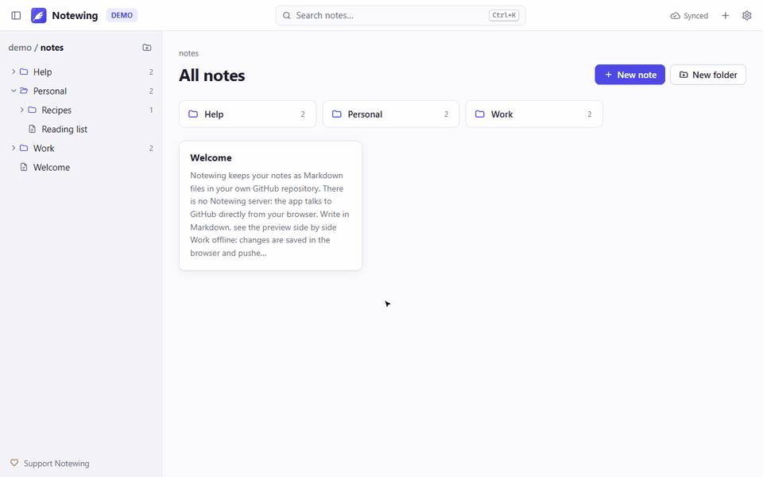
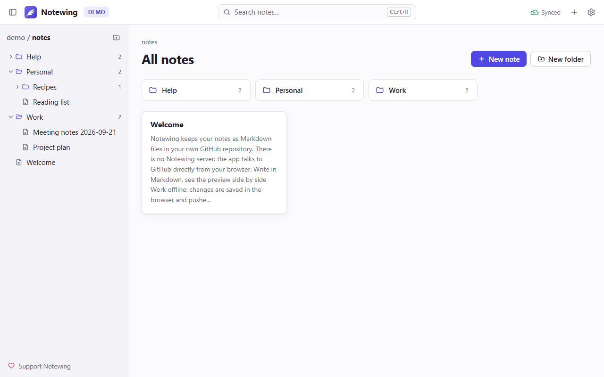
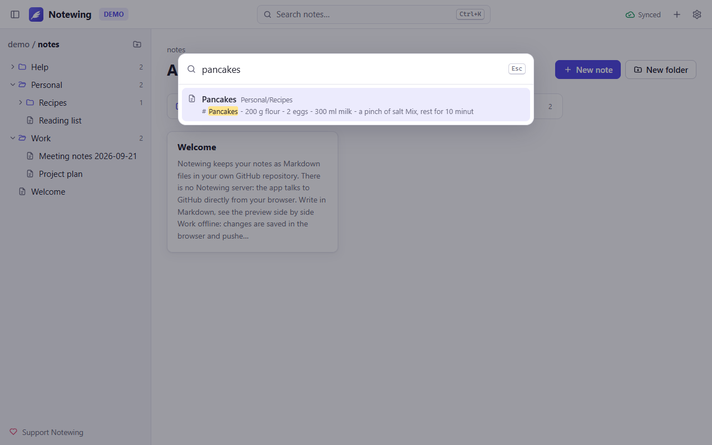
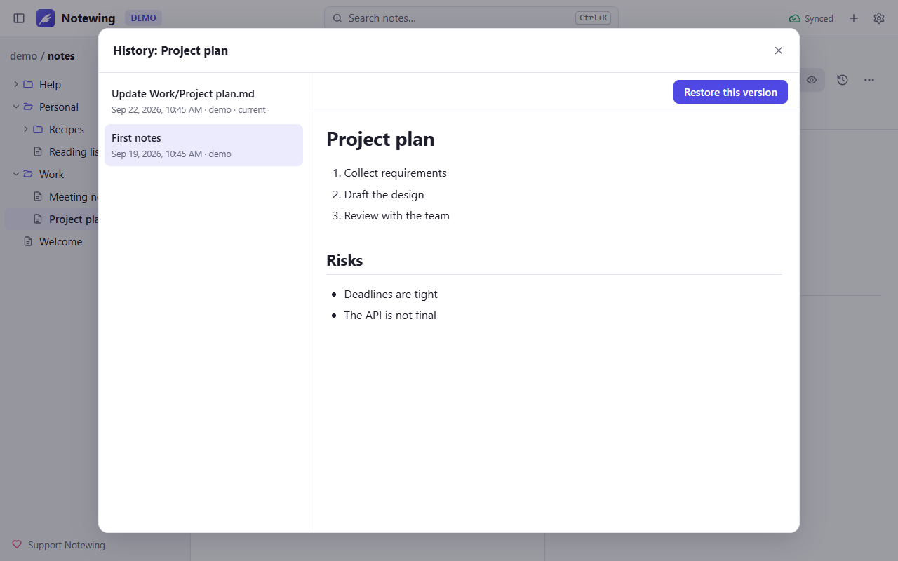
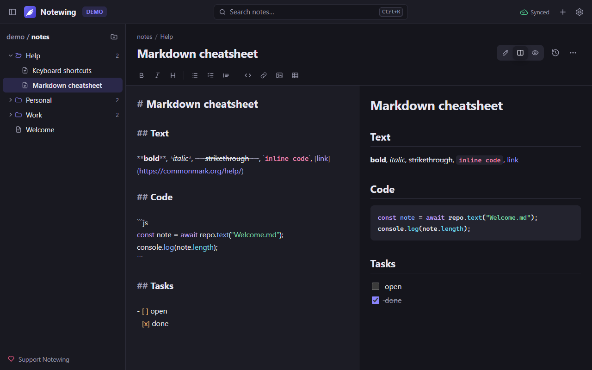
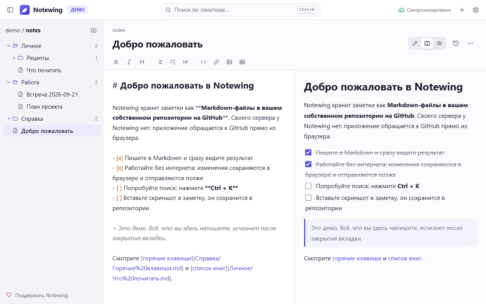

<p align="center">
  
</p>

<h1 align="center">Notewing</h1>

<p align="center">
  <b>Markdown notes in your own GitHub repository. No server in between. Works offline.</b><br>
  <a href="https://perruer.github.io/notewing/"><b>Open Notewing</b></a> ·
  <a href="https://perruer.github.io/notewing/">Try the demo</a> ·
  <a href="#русский">Русский</a> ·
  <a href="#support-the-project">Support</a>
</p>

<p align="center">
  
</p>

Notewing is a notes app for people who want their notes as plain files they own. Every note is a
Markdown file in a GitHub repository of your choice, every save is a commit, and the app runs
entirely in your browser: it talks to `api.github.com` directly, there is no Notewing server and no
account to create.

Notewing is the continuation of [BatNoter](https://github.com/batnoter/batnoter). BatNoter needed its
own server for GitHub login, and that server (batnoter.com) has been offline since late 2022.
Notewing was rewritten to work without one. **Your BatNoter repository works as is.**

## Features

- **Your repository, plain Markdown.** Folders are folders, notes are `.md` files. Read and edit them
  on github.com, in any editor or with git.
- **Works offline.** Notes are kept in the browser. Changes made offline are saved locally and pushed
  when you are back online. Install it as an app (PWA) and it starts without the network.
- **Safe sync.** Changes go to GitHub as one commit a few seconds after you stop typing (or on
  <kbd>Ctrl</kbd>+<kbd>S</kbd>). If a note was changed on another device at the same time, both
  versions are kept: nothing is overwritten.
- **Instant search** over titles and text: <kbd>Ctrl</kbd>+<kbd>K</kbd>.
- **Images:** paste or drop a screenshot into a note. It is stored in your repository (`assets/`) and
  shows up on github.com too.
- **Editor with live preview:** editor, editor + preview, or preview. Syntax highlighting, task lists
  you can tick in the preview, tables, toolbar and shortcuts.
- **History:** every version of a note, from its commits; restore any of them.
- Drag and drop notes and folders, rename, move, delete with undo.
- Focus mode, light and dark theme, English, Russian and Chinese interface.

| | |
|---|---|
|  |  |
|  |  |

## Get started

1. **A repository for your notes.** [Create a private repository](https://github.com/new?name=notes&visibility=private)
   (any name). An existing one works too, including the one you used with BatNoter.
2. **A token for it.** [Create a fine-grained personal access token](https://github.com/settings/personal-access-tokens/new?name=Notewing&description=Notewing%20notes%20app&contents=write):
   - *Repository access* → **Only select repositories** → your notes repository
   - *Permissions* → *Repository permissions* → **Contents: Read and write**
   - pick an expiration date you are comfortable with (you can change the token later in Notewing's
     settings without losing anything)
3. **Open [Notewing](https://perruer.github.io/notewing/)**, paste the token, choose the repository,
   press *Connect*.

Just looking? Press **Try the demo** on the first screen: sample notes, nothing leaves the page.

**Install as an app:** in Chrome or Edge use the install icon in the address bar (or *Settings →
Install Notewing*); on Android *Add to home screen*; on iPhone Safari *Share → Add to Home Screen*.

### Keyboard shortcuts

| Keys | Action |
|---|---|
| <kbd>Ctrl</kbd>+<kbd>K</kbd> | Search notes (also create a note from the search box) |
| <kbd>Alt</kbd>+<kbd>N</kbd> | New note |
| <kbd>Ctrl</kbd>+<kbd>S</kbd> | Sync now |
| <kbd>Ctrl</kbd>+<kbd>E</kbd> | Switch between editor and preview |
| <kbd>Ctrl</kbd>+<kbd>Shift</kbd>+<kbd>F</kbd> | Focus mode |
| <kbd>Ctrl</kbd>+<kbd>\\</kbd> | Show or hide the sidebar |
| <kbd>Ctrl</kbd>+<kbd>B</kbd> / <kbd>I</kbd> | Bold / italic |
| <kbd>Ctrl</kbd>+<kbd>F</kbd> | Find in the note |

On a Mac use <kbd>⌘</kbd> instead of <kbd>Ctrl</kbd>.

## Privacy and security

- Notewing has **no server**. The app is static files; your token and notes go only between your
  browser and `api.github.com`.
- The token is stored in this browser only (or only for the session if you untick *Remember on this
  device*). A fine-grained token limited to one repository and *Contents* is all it needs.
- No analytics, no tracking, no third-party requests. Notes are rendered through DOMPurify and the
  page has a strict Content Security Policy, so a note cannot run code.

Details: [PRIVACY.md](PRIVACY.md).

## Differences from BatNoter

| | BatNoter | Notewing |
|---|---|---|
| Server | Required (batnoter.com, offline since 2022) | None, the browser talks to GitHub |
| Sign-in | GitHub OAuth through the server | Fine-grained token for one repository |
| Offline | No | Yes: local copy, offline edits, installable app |
| Search | Planned (#26, #73) | Full-text, instant |
| Images | No (#85) | Paste or drop, stored in the repository |
| History | No (#53) | Versions from commits, restore |
| Conflicts | Last write wins | Both versions kept |
| Moving notes | No (#55) | Drag and drop, rename, move folders |
| Self-hosting | Server + database (#62, #97) | Any static hosting |
| Interface | English | English, Russian, Chinese (#63) |

## Self-hosting

The app is a folder of static files. Download `notewing-web-<version>.zip` from
[Releases](https://github.com/Perruer/notewing/releases) and put it on any static host (a sub-folder
works), or build it yourself:

```bash
npm ci
npm run build      # output in dist/
```

The server only needs to serve files over HTTPS (or on `localhost`); no configuration or rewrites.

## Development

```bash
npm ci
npm run dev        # http://localhost:5178
npm test           # unit tests: sync engine, search, paths
npm run test:e2e   # end-to-end in Chrome and Firefox against a fake GitHub API
npm run media      # screenshots and demo GIF (needs ffmpeg)
```

`test/e2e/live.mjs` runs the same flows against the real GitHub API on a throw-away repository.
Stack: Preact, CodeMirror 6, marked + DOMPurify, Vite. The sync engine is `src/core/repo.ts`.

## Support the project

Notewing is free, open source and has no ads. If it is useful to you, you can support it:

- **[Boosty](https://boosty.to/mikio_kuroki/donate)** (cards, one-off or monthly)
- **USDT / TRX (TRON, TRC-20):** `TXUBW4e88SDTfrnJRKfbhYfFcggufbonc1`
- **ETH / USDT / USDC (Ethereum, BSC, Polygon and other EVM networks):** `0x1378491169064702786b2E5b58c6375776177E8A`
- **TON / USDT (TON):** `UQAhI7EKzoa-JuKOfv0ULMzA3FrmpxsDkXj8Qevwj2z1cMRN`

A star on GitHub and bug reports help too.

## License

MIT. Based on [BatNoter](https://github.com/batnoter/batnoter), © 2022 batnoter (MIT).
See [LICENSE](LICENSE) and [THIRD_PARTY_NOTICES.md](THIRD_PARTY_NOTICES.md).

---

## Русский

**Notewing** — заметки в Markdown, которые хранятся в вашем собственном репозитории на GitHub.
Своего сервера у приложения нет: оно целиком работает в браузере и обращается к GitHub напрямую.
Работает без интернета. [Открыть Notewing](https://perruer.github.io/notewing/) (есть демо без регистрации).

Это продолжение [BatNoter](https://github.com/batnoter/batnoter): его сервер (batnoter.com) не работает
с конца 2022 года, а Notewing переписан так, чтобы сервер был не нужен. **Репозиторий из BatNoter
подойдёт как есть.**



**Возможности**

- Обычные `.md` файлы в вашем репозитории; каждое сохранение — коммит, вся история на GitHub.
- Работа без сети: изменения сохраняются в браузере и отправляются, когда связь вернётся.
  Можно установить как приложение (PWA).
- Если заметку одновременно изменили на другом устройстве, сохраняются обе версии.
- Мгновенный поиск по тексту (<kbd>Ctrl</kbd>+<kbd>K</kbd>), картинки вставкой из буфера,
  задачи с галочками, история версий с восстановлением, перетаскивание, тёмная тема,
  интерфейс на русском, английском и китайском.

**Как начать**

1. [Создайте приватный репозиторий](https://github.com/new?name=notes&visibility=private) для заметок
   (или возьмите существующий).
2. [Создайте fine-grained токен](https://github.com/settings/personal-access-tokens/new?name=Notewing&contents=write):
   *Only select repositories* → ваш репозиторий, *Permissions → Contents* → **Read and write**.
3. Откройте [Notewing](https://perruer.github.io/notewing/), вставьте токен, выберите репозиторий.

Токен хранится только в вашем браузере и отправляется только на `api.github.com`. Аналитики и слежки нет.

**Поддержать проект:** [Boosty](https://boosty.to/mikio_kuroki/donate) или криптовалютой — адреса
в разделе [Support the project](#support-the-project) выше.
